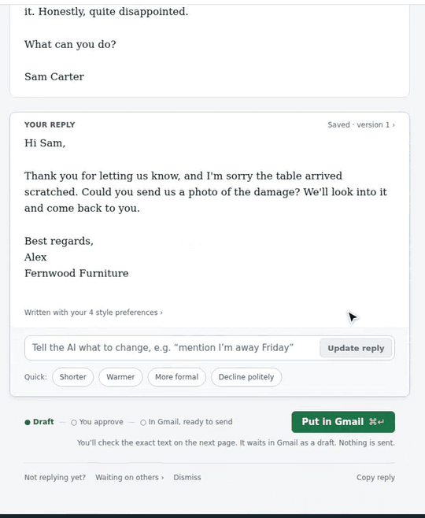
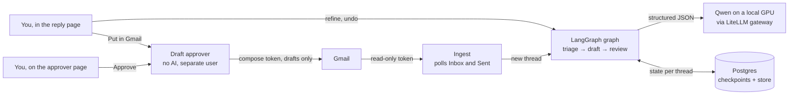

# Customer communication assistant

**Every customer email that needs an answer arrives with the reply already drafted in your business's voice: quotes priced, complaints handled the way you handle them, follow-ups tracked. You correct it in plain words and approve it. It never sends.**

> November 2026 · Source private

*An unhappy customer's reply, corrected in one sentence. Changes are highlighted, and the assistant offers to remember the rule for next time. Demo recording on a sample mailbox.*

**Full demo (3 minutes):** the morning inbox, sorted → a quote with the price worked out → a complaint rewritten in your words → a sales pitch declined → approve all three into Gmail → follow-ups.

<!-- GitHub attachment URL for media/demo.mp4 goes here, on its own line (showcase-playbook.md step 6) -->

## Purpose

**Hypothesis:** customers wait for replies not because writing is hard, but because getting the language right takes time and an AI rarely understands what you mean, your tone and the context. If the draft is already waiting, and fixing it takes one sentence, customers get answered the same day, and no quote or complaint goes quiet.

Most AI email tools either write a generic draft you rewrite by hand, or send on your behalf. This one drafts every reply that needs one, learns how your business answers only when you approve a rule, and leaves the final send to a person. Email through Gmail is the first channel.

## What it does

1. **It reads the inbox** and sorts each new email: needs a reply, for your information, or skip.
2. **It drafts every reply that needs one**, using your saved reply style. If a fact is missing (a lead time, a date), it leaves a gap and asks one question, with answers you can pick.
3. **You correct it in your own words** ("offer a free repair visit and 10% off"). It rewrites around your edits, highlights what changed, and keeps every version for Undo.
4. **It learns only when you say so.** After a correction it may suggest one rule ("when a customer is unhappy, apologise first and offer a concrete fix with a date"). Nothing is remembered until you click Remember, and saved rules stay visible and editable.
5. **You approve the exact text** on a separate page, and it becomes a draft in the original Gmail thread. You press Send in Gmail.
6. **It tracks who owes you an answer.** Once Gmail shows you sent it, a follow-up is due at the deadline in the email, or after 3 business days.

## Architecture

The approach, in six decisions:

- **The AI judges, plain code acts.** The model only produces text: a triage label, a draft, a rewrite. It has no tools. Polling, Gmail drafts, sent detection and follow-up timing are ordinary code.
- **"Never sends" is enforced by structure, not a setting.** Gmail has no "drafts but not send" permission. So the main app holds a read-only token and has no write operation at all. A separate approver, with no model in it, holds the only write token and writes a draft only when you click Approve. A test scans the code and fails on any send call or wider scope.
- **The approver is walled off.** It runs as its own Unix user, keeps its own queue behind a two-call API, forgets the reply text once a request is decided, and accepts a click only from its own page, so a compromised app can't press Approve through your browser.
- **One email, one paused run.** Each Gmail thread is a LangGraph thread. The graph pauses at review with `interrupt()` and resumes on your click with `Command(resume=…)`. Postgres checkpoints keep the run across restarts. Versions are append-only, which is what makes Undo safe.
- **Customer mail stays on a private model.** Triage and drafting run on Qwen on a dedicated GPU server, through a LiteLLM gateway that traces every call to Langfuse. A cloud model can be picked per thread, and only that thread is sent to it.
- **The app processing untrusted email is isolated.** It runs in its own VM as a service user, with an egress allowlist and one network path to the approver.

| Part | Choice |
|---|---|
| Orchestration | LangGraph (StateGraph, interrupts, Postgres checkpointer and store) |
| Model | Qwen on vLLM, local; LiteLLM gateway; Langfuse tracing |
| App | FastAPI, Jinja, htmx |
| Gmail | Google API client; read-only for the app, compose for the approver only |
| Data | PostgreSQL |
| Tests | 364 automated tests, including a fake Gmail that fails on any send |

## Selected source

The full codebase is private. Three files show the decisions above in code:

| File | What it shows |
|---|---|
| [`source/graph.py`](source/graph.py) | The LangGraph workflow for one email thread: triage, draft, and a review step that pauses with `interrupt()` and resumes on the user's decision. Versions are append-only, so Undo never loses work. |
| [`source/never_send_check.py`](source/never_send_check.py) | The gate that fails the build on any Gmail send call or any permission wider than read-only and drafts. |
| [`source/approver_guard.py`](source/approver_guard.py) | How the approver accepts a click only from its own page: same-origin checks, a signed token per request, and no framing. |

## Outcome

In use since November 2026. How the hypothesis is measured:

| Metric | What it tests | Result |
|---|---|---|
| Time from important email arriving to reply sent | A ready draft gets replies out sooner | Pending |
| Share of drafts sent with only a sentence or two of correction | It understands what the business means and its tone | Pending |
| Follow-ups sent on time | Tracking stops threads going quiet | Pending |

## What I learned

- **Fewer places to type beats more features.** The reply page started with five inputs: the reply, an answer box, quick buttons, a refine box and Save. Each was a small "which one do I use?" decision. It became one bar, and got easier every time something was taken out.
- **Let the model work out intent.** Suggested answers first sent on tap, with a switch for "this is an instruction, not an answer". "Wednesday, and mention I'm away Friday" broke it. Now the question, the pick and the typed text go together and the model sorts them out.
- **Name actions by what the user gets.** "Send for approval" sounded like sending email. "Put in Gmail", with "Nothing is sent" underneath, says what happens.
- **Permissions can't make a promise that scopes don't.** The draft permission can also send. Keeping that promise took a second service, not a flag.
- **Network isolation doesn't stop the browser.** A compromised page could make the owner's own browser press Approve. Pages that act need an origin check and a per-action token.
- **Local models need guard rails in code.** Qwen's reasoning leaked into structured fields until output went through guided JSON with thinking turned off. Refine kept rewording the user's own sentences until the prompt said so plainly and a live check enforced it.
- **Real Gmail is messier than the docs.** Sent drafts get new ids, the order of polling Inbox and Sent matters, and notes to self land in both. Each was a real bug.
- **The agreed design is the spec.** Small differences from the prototype were waved through, one only so an old test would pass. Building against an interactive prototype fixed it.

---

More about me at [shrikantvarma.com](https://shrikantvarma.com).
